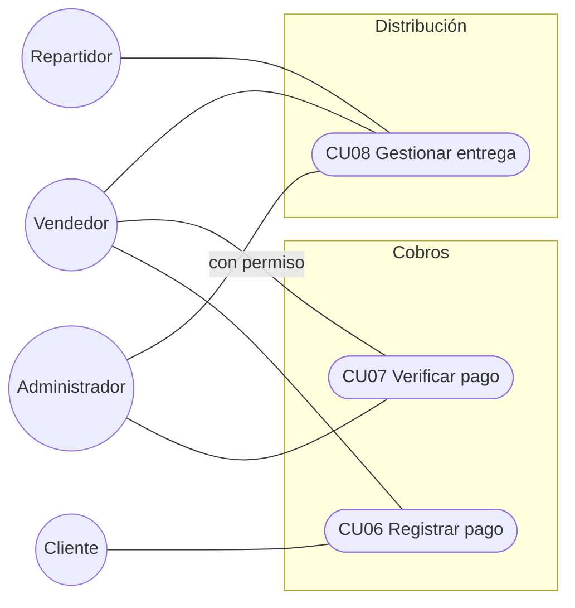
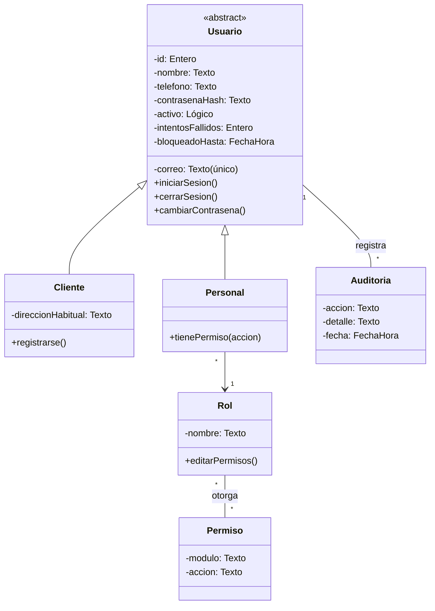
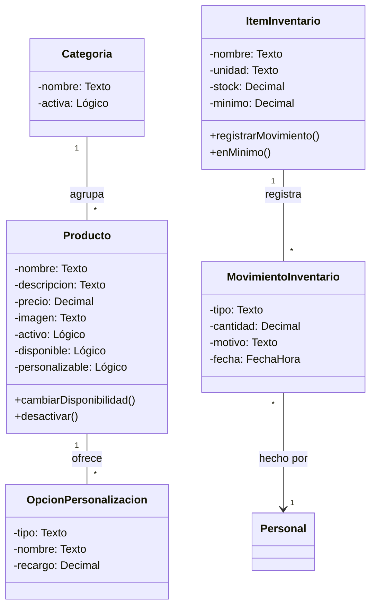
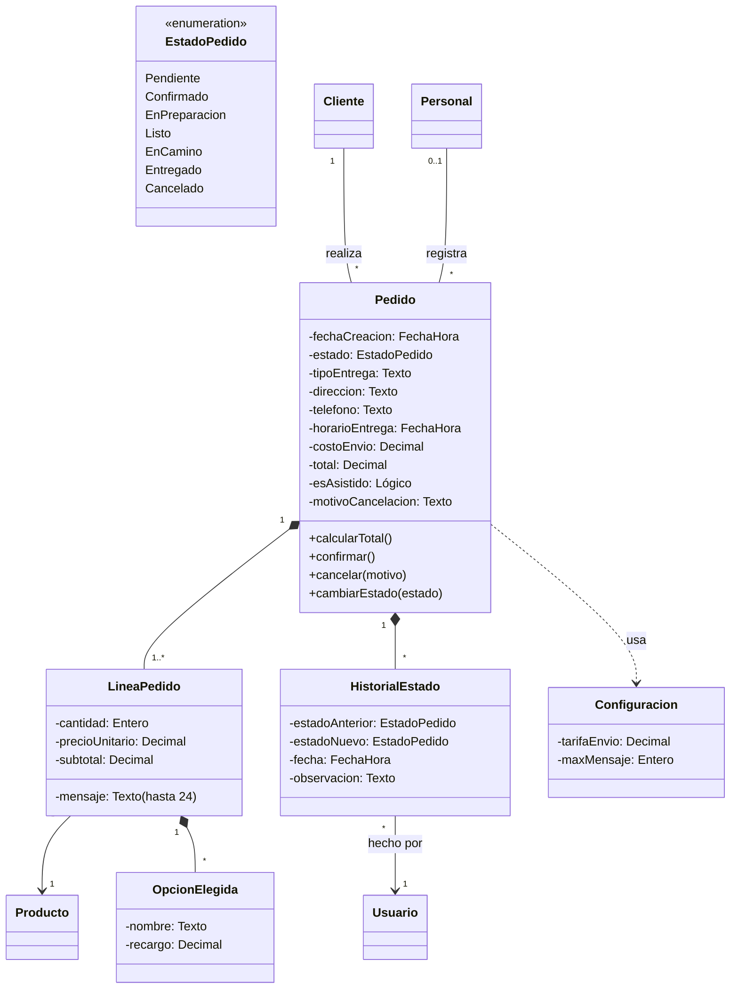
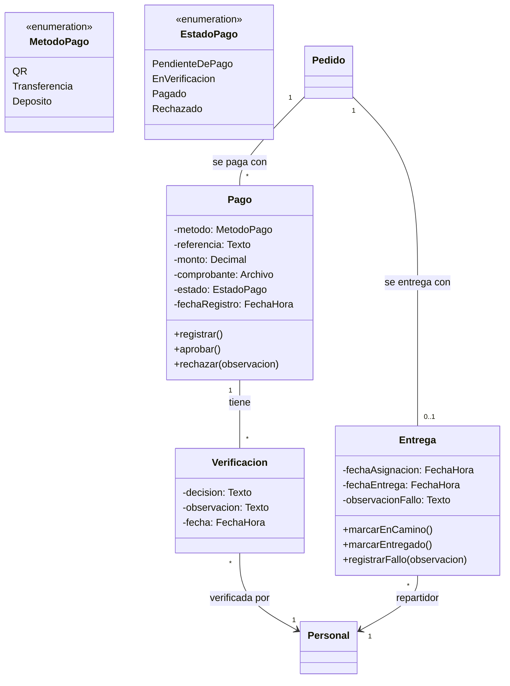
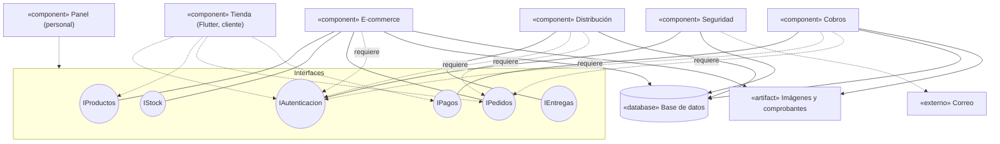
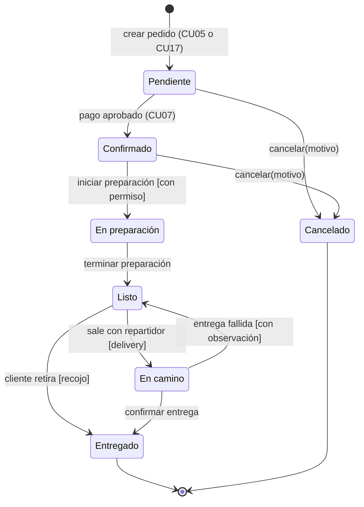
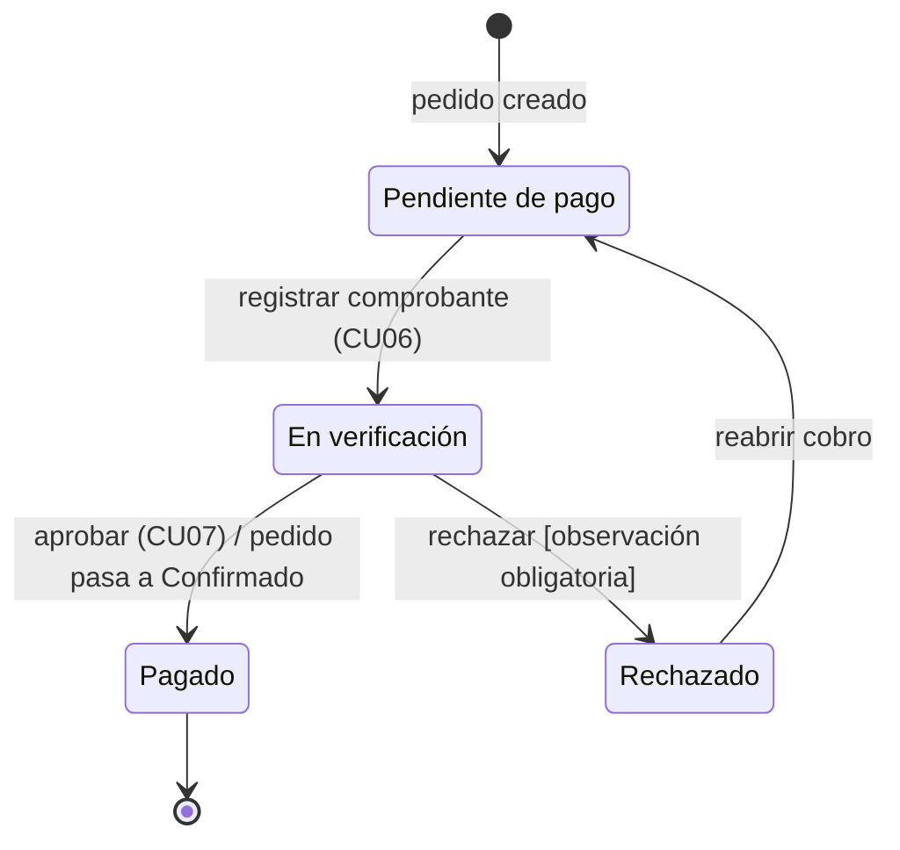

# Dulces Aromas — Modelos UML v1

Versión 1.0 · 29/10/2026. Los diagramas originales están en el documento de Claude; aquí se reproducen en Mermaid para que GitHub los muestre.

## 1. Introducción

Este documento reúne los cuatro modelos UML de Dulces Aromas: casos de uso, clases, componentes y estados. Cada uno responde una pregunta distinta sobre el mismo sistema, y los cuatro usan los nombres, roles y reglas de la Visión v1, los Casos de Uso v1 y las Historias v1.

| Modelo | Pregunta que responde | Fuente principal |
| --- | --- | --- |
| Casos de uso | ¿Qué hace el sistema y para quién? | CU01 a CU17, actores |
| Clases | ¿Con qué objetos trabaja? | RF, RN, datos de los CU |
| Componentes | ¿De qué piezas se arma y cómo se comunican? | Módulos de la Visión, RNF17 |
| Estados | ¿Cómo reacciona a los eventos un pedido o un pago? | Sección 2 de los CU |

La notación es UML 2.5. Los nombres de clases, atributos y estados están en español, igual que el resto del proyecto.

## 2. Modelo de casos de uso

Son 17 casos de uso en cuatro módulos y cuatro roles. Un diagrama por módulo mantiene legibles las relaciones. Donde los cuatro roles hacen lo mismo se usa el actor abstracto Usuario, del que heredan Cliente, Administrador, Vendedor y Repartidor.

### 2.1 Seguridad

Usuario inicia sesión (CU01), recupera su contraseña (CU12, que extiende a CU01 cuando la olvidó) y gestiona su perfil (CU13). Solo el Cliente se registra (CU11) y solo el Administrador gestiona usuarios y permisos (CU09).

### 2.2 E-commerce

El Vendedor solo cambia la disponibilidad en CU02 y solo consulta en CU03.

El Cliente consulta el catálogo, hace pedidos, ve sus pedidos y los cancela. El Vendedor registra pedidos asistidos (CU17), que incluyen las reglas de CU05. El Administrador gestiona productos, categorías e inventario. Cancelar (CU16) lo hacen el Cliente y el personal con permiso de pedidos.

### 2.3 Cobros y Distribución

El Cliente registra el pago (CU06); el Administrador o el Vendedor con permiso lo verifica (CU07). Con el pago aprobado, el personal prepara y asigna, y el Repartidor entrega (CU08).

### 2.4 Actores y casos de uso

| Caso de uso | Cliente | Administrador | Vendedor | Repartidor |
| --- | --- | --- | --- | --- |
| CU01 Iniciar y cerrar sesión | Sí | Sí | Sí | Sí |
| CU02 Gestionar productos | No | Sí | Solo disponibilidad | No |
| CU03 Gestionar inventario | No | Sí | Solo consulta | No |
| CU04 Consultar catálogo | Sí | Sí | Sí | No |
| CU05 Hacer un pedido | Sí | No | No | No |
| CU06 Registrar pago | Sí | No | Pedido asistido | No |
| CU07 Verificar pago | No | Sí | Con permiso | No |
| CU08 Gestionar entrega | No | Sí | Sí | Solo las suyas |
| CU09 Gestionar usuarios y permisos | No | Sí | No | No |
| CU10 Consultar pedidos y ventas | No | Sí | Solo pedidos | No |
| CU11 Registrarse como cliente | Sí | No | No | No |
| CU12 Recuperar contraseña | Sí | Sí | Sí | Sí |
| CU13 Gestionar perfil | Sí | Sí | Sí | Sí |
| CU14 Gestionar categorías | No | Sí | No | No |
| CU15 Consultar mis pedidos | Sí | No | No | No |
| CU16 Cancelar pedido | Sí | Sí | Sí | No |
| CU17 Registrar pedido asistido | No | Sí | Sí | No |

El Administrador puede hacer todo lo que hace el Vendedor; los diagramas dibujan solo las asociaciones principales de cada rol para no saturarlos, y esta tabla es la referencia completa.

## 3. Modelo de clases

El modelo se parte en cuatro diagramas, uno por módulo y el de E-commerce en dos, para que cada uno quepa en una pantalla. Las clases que aparecen en más de un diagrama se dibujan completas solo en el primero. Los tipos son Entero, Decimal, Texto, Lógico, Fecha y FechaHora; el signo «-» marca atributos privados y «+» métodos públicos.

### 3.1 Seguridad

Cliente y Personal heredan de Usuario. El personal tiene un solo rol y cada rol reúne permisos; Auditoría guarda quién cambió usuarios, roles y permisos (RF28, RNF08). Un cliente nunca tiene rol de personal (RN16).

### 3.2 Catálogo e inventario

La disponibilidad es un indicador manual del producto (D2); no se calcula con el stock de insumos.

Una categoría agrupa productos y un producto ofrece opciones de personalización, cada una con su recargo fijo (D9). El inventario controla insumos y sus movimientos, y cada movimiento lo registra una persona del personal (RN09, CU03).

### 3.3 Pedidos

Un cliente realiza muchos pedidos; un pedido asistido lo registra una persona del personal (RF34). El total se calcula con las líneas, los recargos de las opciones elegidas y la tarifa de envío de Configuración (RN11). Las opciones elegidas guardan una copia del nombre y del recargo, para que un cambio posterior en el producto no altere pedidos anteriores. Cada cambio de estado deja una fila en HistorialEstado (RF43).

### 3.4 Cobros y Distribución

Un pedido puede tener varios pagos porque un comprobante rechazado obliga a registrar otro (RN07). Cada decisión queda en Verificacion con quién la tomó (RF39). La entrega existe solo para pedidos con delivery y apunta al repartidor asignado (RF40).

### 3.5 Diccionario de clases

| Clase | Módulo | Responsabilidad |
| --- | --- | --- |
| Usuario | Seguridad | Credenciales, estado de la cuenta y bloqueo por intentos |
| Cliente | Seguridad | Persona que compra desde la Tienda |
| Personal | Seguridad | Cuenta del Panel con un rol fijo |
| Rol | Seguridad | Administrador, Vendedor o Repartidor, con sus permisos |
| Permiso | Seguridad | Acción permitida sobre un módulo |
| Auditoría | Seguridad | Registro de cambios en usuarios, permisos y pagos |
| Categoría | E-commerce | Agrupa productos para el filtro del catálogo |
| Producto | E-commerce | Lo que se vende, con precio y disponibilidad |
| OpcionPersonalizacion | E-commerce | Tamaño, sabor, relleno o decoración con su recargo |
| ItemInventario | E-commerce | Insumo con stock y mínimo |
| MovimientoInventario | E-commerce | Entrada, salida o ajuste de un insumo |
| Pedido | E-commerce | Compra de un cliente con su estado y su entrega |
| LineaPedido | E-commerce | Producto, cantidad y mensaje dentro de un pedido |
| OpcionElegida | E-commerce | Copia de la opción y del recargo elegidos |
| HistorialEstado | E-commerce | Cada cambio de estado de un pedido |
| Configuracion | E-commerce | Tarifa fija de envío y largo máximo del mensaje |
| Pago | Cobros | Intento de pago con método, referencia y comprobante |
| Verificacion | Cobros | Aprobación o rechazo de un pago |
| Entrega | Distribución | Asignación, entrega o fallo de un pedido con delivery |

## 4. Modelo de componentes

El sistema tiene dos interfaces de usuario, cuatro componentes de negocio y tres recursos de soporte. Cada módulo ofrece interfaces y los demás las usan; ningún módulo accede a los datos de otro sin pasar por su interfaz (RNF17).

La flecha discontinua va del componente que requiere hacia la interfaz que usa. Cobros llama a IPedidos para pasar el pedido a Confirmado cuando aprueba un pago, y Distribución la usa para leer pedidos listos y actualizar su estado. Esto corrige el diagrama anterior, donde las flechas entre Pedidos, Cobranza y Distribución iban en sentido contrario.

| Componente | Provee | Requiere |
| --- | --- | --- |
| Tienda | — | IAutenticacion, IProductos, IPedidos, IPagos |
| Panel | — | Las seis interfaces |
| Seguridad | IAutenticacion | Correo, Base de datos |
| E-commerce | IProductos, IStock, IPedidos | IAutenticacion, Base de datos, Imágenes |
| Cobros | IPagos | IAutenticacion, IPedidos, Base de datos, Comprobantes |
| Distribución | IEntregas | IAutenticacion, IPedidos, Base de datos |

## 5. Modelo de estados

El pedido y el pago tienen máquinas de estado separadas. Se conectan en un solo punto: aprobar el pago pasa el pedido de Pendiente a Confirmado (RN05, D1). Cada transición se escribe como evento \[guarda\] / acción.

### 5.1 Pedido

El estado resaltado, Confirmado, es la puerta: sin él no hay preparación. Un pedido se cancela solo desde Pendiente o Confirmado (RN14). El recojo salta de Listo a Entregado sin pasar por En camino, y una entrega fallida devuelve el pedido a Listo con observación (RN13).

### 5.2 Pago

Un rechazo exige observación y reabre el cobro, así que un pedido puede acumular varios pagos hasta que uno se apruebe (RN07). Aprobar un pago es el único evento que cambia el estado de otro objeto, el pedido.

## 6. Consistencia entre modelos

Los cuatro modelos usan los mismos nombres. Esta tabla muestra dónde aparece cada elemento clave en cada modelo y qué regla lo sostiene.

| Elemento | Casos de uso | Clases | Componentes | Estados | Regla o requisito |
| --- | --- | --- | --- | --- | --- |
| Roles fijos | Actores Cliente, Administrador, Vendedor, Repartidor | Usuario, Cliente, Personal, Rol, Permiso | Seguridad, IAutenticacion | Guardas \[con permiso\] | RN16, D6 |
| Pedido | CU05, CU15, CU16, CU17 | Pedido, LineaPedido, HistorialEstado | E-commerce, IPedidos | Máquina del Pedido | RF13, RF43 |
| Pago antes de preparar | CU06, CU07 | Pago, Verificacion | Cobros requiere IPedidos | Pagado lleva el pedido a Confirmado | RN05, D1 |
| Rechazo de pago | CU07 alt. 1 y 2 | Verificacion.observacion | Cobros | Rechazado a Pendiente de pago | RN07 |
| Cancelación | CU16 | Pedido.motivoCancelacion | IPedidos | Desde Pendiente o Confirmado | RN14, D8 |
| Entrega fallida | CU08 alt. 2 | Entrega.observacionFallo | Distribución, IEntregas | En camino a Listo | RN13 |
| Recojo | CU08 | Pedido.tipoEntrega | Distribución | Listo a Entregado | RN12 |
| Total y envío | CU05 | Pedido.calcularTotal(), Configuracion.tarifaEnvio, OpcionElegida | E-commerce | — | RN11, D4, D9 |
| Mensaje de la torta | CU05 alt. 3b | LineaPedido.mensaje, Configuracion.maxMensaje | E-commerce | — | RN17 |
| Disponibilidad manual | CU02, CU04 | Producto.disponible (sin relación con ItemInventario) | IProductos, IStock separadas | — | RN08, D2 |
| Auditoría | CU07, CU09 | Auditoría, Verificacion | Seguridad | — | RF28, RNF08 |

Dos supuestos de modelado que el equipo puede cambiar: un pedido tiene varios pagos (uno por intento) y la entrega es una clase aparte que solo existe para pedidos con delivery.
