# Dulces Aromas — Modelos UML v1

Versión 1.4 · 13/11/2026. Los diagramas originales están en el documento de Claude; aquí se reproducen en Mermaid para que GitHub los muestre.

## 1. Introducción

Este documento reúne los cuatro modelos UML de Dulces Aromas: casos de uso, clases, componentes y estados. Cada uno responde una pregunta distinta sobre el mismo sistema, y los cuatro usan los nombres, roles y reglas de la Visión v1, los Casos de Uso v1 y las Historias v1.

| Modelo | Pregunta que responde | Fuente principal |
| --- | --- | --- |
| Casos de uso | ¿Qué hace el sistema y para quién? | CU01 a CU17, actores |
| Clases | ¿Con qué objetos trabaja? | RF, RN, datos de los CU |
| Componentes | ¿De qué piezas se arma, cómo se comunican y dónde corre cada una? | Módulos de la Visión, RNF17, RNF21 |
| Estados | ¿Cómo reacciona a los eventos un pedido o un pago? | Sección 2 de los CU |

La notación es UML 2.5. Los nombres de clases, atributos y estados están en español, igual que el resto del proyecto.

## 2. Modelo de casos de uso

Son 17 casos de uso en cuatro módulos y cuatro roles. Un diagrama por módulo mantiene legibles las relaciones. Donde los cuatro roles hacen lo mismo se usa el actor abstracto Usuario, del que heredan Cliente, Administrador, Vendedor y Repartidor.

### 2.1 Seguridad

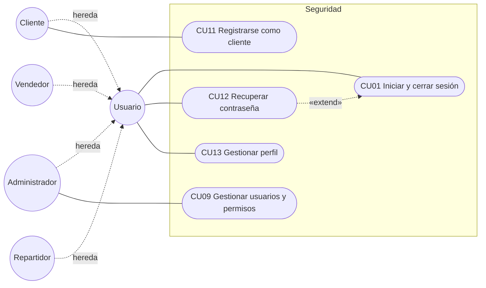

Usuario inicia sesión (CU01), recupera su contraseña (CU12, que extiende a CU01 cuando la olvidó) y gestiona su perfil (CU13). Solo el Cliente se registra (CU11) y solo el Administrador gestiona usuarios y permisos (CU09).

### 2.2 E-commerce

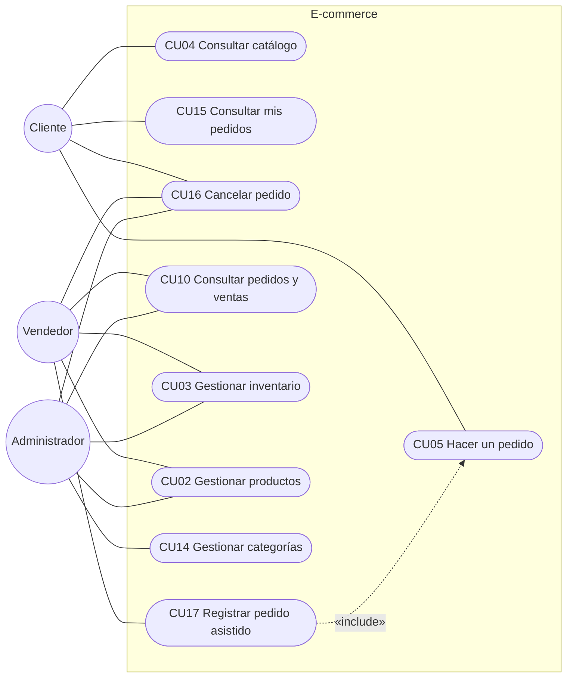
El Vendedor solo cambia la disponibilidad en CU02 y solo consulta en CU03.

El Cliente consulta el catálogo, hace pedidos, ve sus pedidos y los cancela. El Vendedor registra pedidos asistidos (CU17), que incluyen las reglas de CU05. El Administrador gestiona productos, categorías e inventario. Cancelar (CU16) lo hacen el Cliente y el personal con permiso de pedidos.

### 2.3 Cobros y Distribución

El Cliente registra el pago (CU06); el Administrador o el Vendedor con permiso lo verifica (CU07). Con el pago aprobado, el personal prepara y asigna, y el Repartidor entrega (CU08).

### 2.4 Actores y casos de uso

| Caso de uso | Cliente | Administrador | Vendedor | Repartidor |
| --- | --- | --- | --- | --- |
| CU01 Iniciar y cerrar sesión | Sí | Sí | Sí | Sí |
| CU02 Gestionar productos | No | Sí | Solo disponibilidad | No |
| CU03 Gestionar inventario | No | Sí | Solo consulta | No |
| CU04 Consultar catálogo | Sí | Sí | Sí | No |
| CU05 Hacer un pedido | Sí | No | No | No |
| CU06 Registrar pago | Sí | No | Pedido asistido | No |
| CU07 Verificar pago | No | Sí | Con permiso | No |
| CU08 Gestionar entrega | No | Sí | Sí | Solo las suyas |
| CU09 Gestionar usuarios y permisos | No | Sí | No | No |
| CU10 Consultar pedidos y ventas | No | Sí | Solo pedidos | No |
| CU11 Registrarse como cliente | Sí | No | No | No |
| CU12 Recuperar contraseña | Sí | Sí | Sí | Sí |
| CU13 Gestionar perfil | Sí | Sí | Sí | Sí |
| CU14 Gestionar categorías | No | Sí | No | No |
| CU15 Consultar mis pedidos | Sí | No | No | No |
| CU16 Cancelar pedido | Sí | Sí | Sí | No |
| CU17 Registrar pedido asistido | No | Sí | Sí | No |

El Administrador puede hacer todo lo que hace el Vendedor; los diagramas dibujan solo las asociaciones principales de cada rol para no saturarlos, y esta tabla es la referencia completa.

## 3. Modelo de clases

El modelo se parte en cuatro diagramas, uno por módulo y el de E-commerce en dos, para que cada uno quepa en una pantalla. Las clases que aparecen en más de un diagrama se dibujan completas solo en el primero. Los tipos son Entero, Decimal, Texto, Lógico, Fecha y FechaHora; el signo «-» marca atributos privados y «+» métodos públicos.

### 3.1 Seguridad

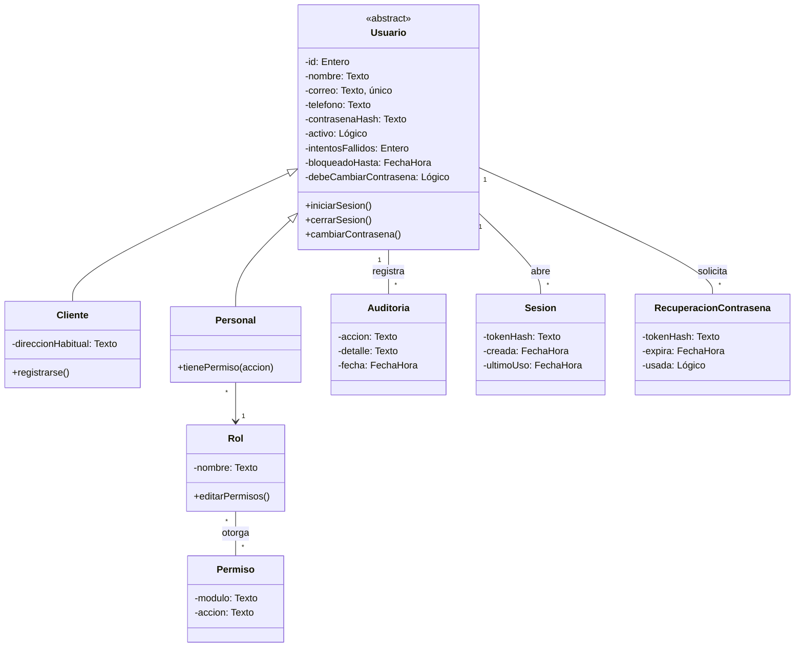

Cliente y Personal heredan de Usuario. El personal tiene un solo rol y cada rol reúne permisos; Auditoría guarda quién cambió usuarios, roles y permisos (RF28, RNF08). Un cliente nunca tiene rol de personal (RN16). Cada sesión guarda solo el hash de su token, para cerrarla por inactividad (RNF06), al salir o al desactivar la cuenta. La recuperación de contraseña es un enlace de un solo uso que vence en 60 minutos (D5); cuando el administrador restablece una contraseña, debeCambiarContrasena obliga a cambiarla al ingresar.

### 3.2 Catálogo e inventario

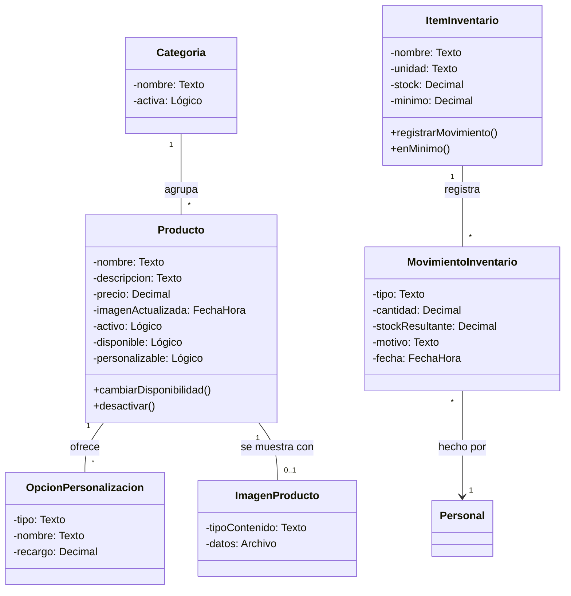
La disponibilidad es un indicador manual del producto (D2); no se calcula con el stock de insumos. La imagen va en su propia clase, ImagenProducto, para no cargar los bytes cada vez que se lee un producto; el producto solo guarda cuándo cambió, para que la app no muestre una copia vieja.

Una categoría agrupa productos y un producto ofrece opciones de personalización, cada una con su recargo fijo (D9). El inventario controla insumos y sus movimientos, y cada movimiento lo registra una persona del personal (RN09, CU03). Una entrada suma, una salida resta y un ajuste fija el stock al valor contado.

### 3.3 Pedidos

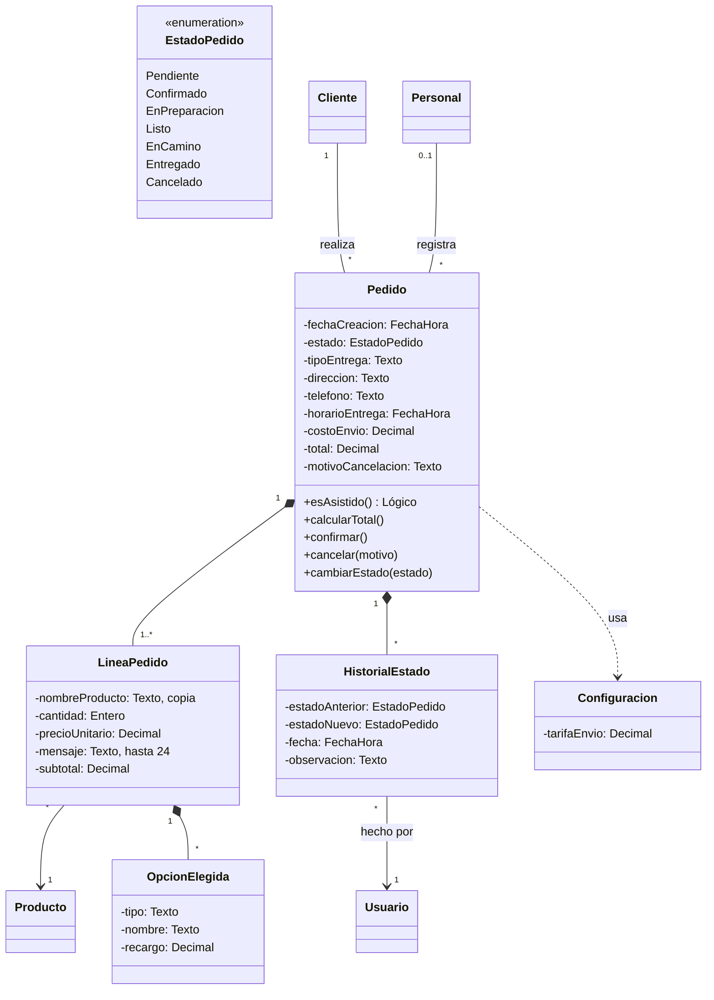

Un cliente realiza muchos pedidos; un pedido asistido lo registra una persona del personal (RF34), y esAsistido() dice si el pedido tiene quien lo registró. El total se calcula con las líneas, los recargos de las opciones elegidas y la tarifa de envío de Configuración (RN11). La línea guarda una copia del nombre y del precio del producto, y cada opción elegida, una copia de su tipo, nombre y recargo, para que un cambio posterior en el producto no altere pedidos anteriores. Cada cambio de estado deja una fila en HistorialEstado (RF43).

### 3.4 Cobros y Distribución

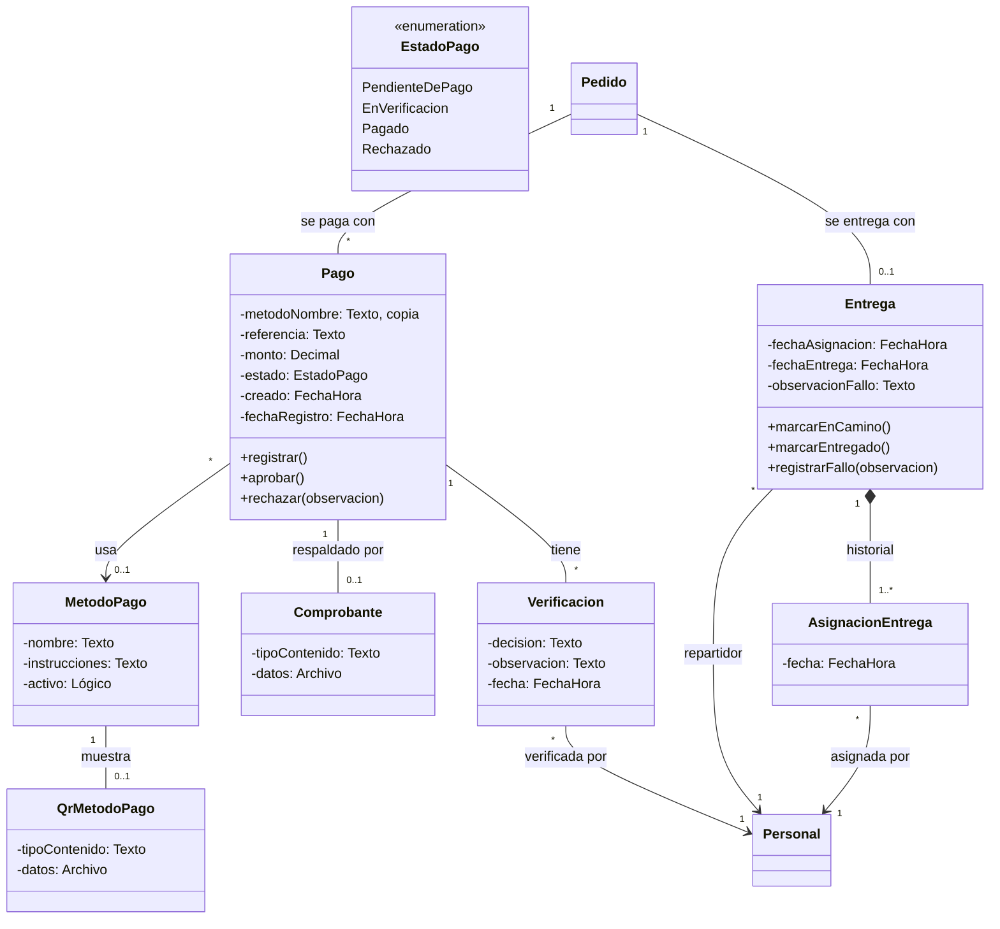

Un pedido puede tener varios pagos porque un comprobante rechazado obliga a registrar otro (RN07). MetodoPago es una clase y no una enumeración: el administrador agrega métodos y edita sus datos para pagar desde el Panel, sin cambiar código (RNF18). El pago guarda una copia del nombre del método, por si luego se renombra. El pago nace Pendiente de pago al crearse el pedido (creado) y se registra cuando el cliente sube el comprobante (fechaRegistro). El comprobante y el QR de cada método van en sus propias clases, Comprobante y QrMetodoPago, para no cargar los archivos cada vez que se lee un pago o un método. Cada decisión queda en Verificacion con quién la tomó (RF39). La entrega existe solo para pedidos con delivery y apunta al repartidor asignado (RF40). Cada asignación o cambio de repartidor queda en AsignacionEntrega (CU08, alt. 4).

### 3.5 Diccionario de clases

| Clase | Módulo | Responsabilidad |
| --- | --- | --- |
| Usuario | Seguridad | Credenciales, estado de la cuenta y bloqueo por intentos |
| Cliente | Seguridad | Persona que compra desde la Tienda |
| Personal | Seguridad | Cuenta del Panel con un rol fijo |
| Rol | Seguridad | Administrador, Vendedor o Repartidor, con sus permisos |
| Permiso | Seguridad | Acción permitida sobre un módulo |
| Auditoría | Seguridad | Registro de cambios en usuarios y permisos, bloqueos y accesos denegados |
| Sesion | Seguridad | Sesión abierta, con el hash de su token y su último uso |
| RecuperacionContrasena | Seguridad | Enlace de un solo uso para definir una contraseña nueva |
| Categoría | E-commerce | Agrupa productos para el filtro del catálogo |
| Producto | E-commerce | Lo que se vende, con precio y disponibilidad |
| OpcionPersonalizacion | E-commerce | Tamaño, sabor, relleno o decoración con su recargo |
| ImagenProducto | E-commerce | La foto del producto, cuadrada y de 1200 px como máximo (RNF10) |
| ItemInventario | E-commerce | Insumo con stock y mínimo |
| MovimientoInventario | E-commerce | Entrada, salida o ajuste de un insumo |
| Pedido | E-commerce | Compra de un cliente con su estado y su entrega |
| LineaPedido | E-commerce | Producto, cantidad y mensaje dentro de un pedido |
| OpcionElegida | E-commerce | Copia de la opción y del recargo elegidos |
| HistorialEstado | E-commerce | Cada cambio de estado de un pedido |
| Configuracion | E-commerce | Tarifa fija de envío |
| Pago | Cobros | Intento de pago con método, referencia y comprobante |
| MetodoPago | Cobros | QR, transferencia, depósito u otro, con sus datos para pagar |
| Comprobante | Cobros | El archivo JPG, PNG o PDF que respalda un pago (RNF09) |
| QrMetodoPago | Cobros | La imagen del QR de un método de pago |
| Verificacion | Cobros | Aprobación o rechazo de un pago |
| Entrega | Distribución | Asignación, entrega o fallo de un pedido con delivery |
| AsignacionEntrega | Distribución | Cada asignación o cambio de repartidor de una entrega |

## 4. Modelo de componentes

El sistema tiene dos interfaces de usuario, cuatro componentes de negocio y tres recursos de soporte. Las imágenes y los comprobantes son archivos, pero se guardan dentro de la base de datos (sección 4.1). Cada módulo ofrece interfaces y los demás las usan; ningún módulo accede a los datos de otro sin pasar por su interfaz (RNF17).

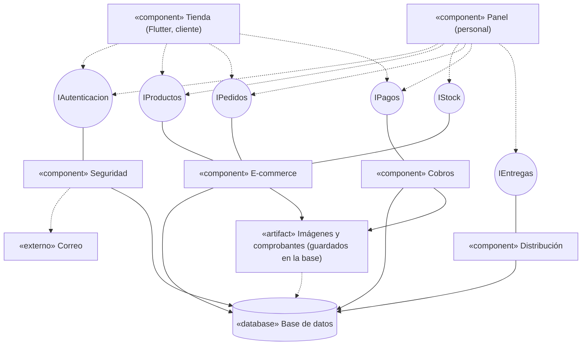

Lo que cada componente de negocio requiere de los demás:

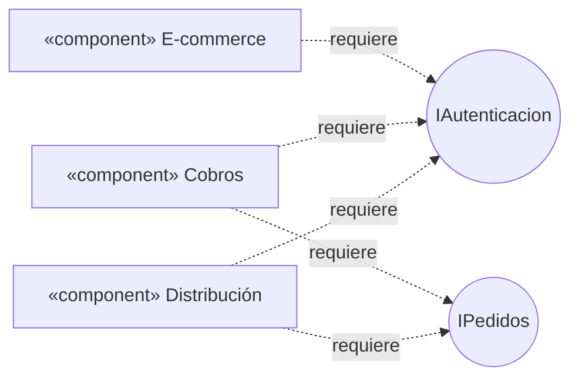

El primer diagrama se lee de arriba abajo: la Tienda y el Panel usan las interfaces (flecha discontinua), cada componente de negocio provee las suyas (línea continua) y guarda sus datos en los recursos de soporte. El segundo muestra qué interfaz de otro módulo requiere cada componente; la flecha va del que requiere hacia la interfaz que usa. Cobros llama a IPedidos para pasar el pedido a Confirmado cuando aprueba un pago, y Distribución la usa para leer pedidos listos y actualizar su estado. Cuando E-commerce necesita que otro módulo reaccione, publica un evento: al crearse un pedido, el evento PedidoRegistrado hace que Cobros abra su pago Pendiente de pago, en la misma transacción. Así E-commerce no depende de Cobros. Esto corrige el diagrama anterior, donde las flechas entre Pedidos, Cobranza y Distribución iban en sentido contrario.

| Componente | Provee | Requiere |
| --- | --- | --- |
| Tienda | — | IAutenticacion, IProductos, IPedidos, IPagos |
| Panel | — | Las seis interfaces |
| Seguridad | IAutenticacion | Correo, Base de datos |
| E-commerce | IProductos, IStock, IPedidos | IAutenticacion, Base de datos, Imágenes |
| Cobros | IPagos | IAutenticacion, IPedidos, Base de datos, Comprobantes |
| Distribución | IEntregas | IAutenticacion, IPedidos, Base de datos |

En el código, cada interfaz está en el paquete raíz de su módulo, que es lo único que los demás pueden usar; la clase que la implementa queda en un subpaquete interno. Los controladores REST, que atienden a la Tienda y al Panel, también pasan por la interfaz.

| Interfaz | Paquete | La implementa | La usan |
| --- | --- | --- | --- |
| IAutenticacion | `seguridad` | `AdaptadorAutenticacion` | E-commerce, Cobros y Distribución, para saber quién hace cada acción |
| IProductos | `ecommerce` | `AdaptadorProductos` (catálogo) | Pedidos, para calcular el total con los precios y opciones de hoy |
| IStock | `ecommerce` | `InventarioServicio` | El controlador de inventario |
| IPedidos | `ecommerce` | `AdaptadorPedidos` | Cobros y Distribución; también el catálogo, para no borrar un producto con pedidos (RN10) |
| IPagos | `cobros` | `PagoServicio` | El controlador de pagos |
| IEntregas | `distribucion` | `EntregaServicio` | El controlador de entregas |

Catálogo, inventario y pedidos forman un solo módulo, así que Spring Modulith no impide que uno use las clases del otro. Por eso la prueba `InterfacesTests` comprueba que Pedidos no use las clases internas del catálogo ni del inventario, que cada consulta a la base lea solo las tablas de su propio paquete y que los controladores usen la interfaz de su módulo. `ModularidadTests` comprueba el resto.

### 4.1 Despliegue en la nube

El modelo de componentes dice de qué piezas se arma el sistema; el de despliegue dice dónde corre cada una. Todo se publica desde el repositorio con planes gratuitos y sin cambiar código: la configuración entra por variables de entorno (RNF21).

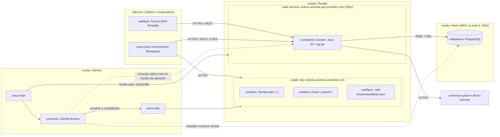

| Nodo | Tecnología | Qué corre ahí | Configuración |
| --- | --- | --- | --- |
| Servicio web | Render, plan gratuito (512 MB), región Ohio | La API dentro de un contenedor Docker | `render.yaml`, `backend/Dockerfile` y variables de entorno |
| Sitio estático | Render | La Tienda web en `/` y el Panel en `/panel/`, ya compilados | `render.yaml`; las rutas de Flutter responden con su `index.html` |
| Base de datos | Neon, PostgreSQL administrado, AWS us-east-2 | Las tablas que crea Flyway, con imágenes y comprobantes | `DB_URL`, `DB_USER`, `DB_PASSWORD`; conexión directa, sin pooler |
| Correo | Brevo, API HTTPS | El envío del enlace de recuperación (CU12) | `BREVO_CLAVE`, `MAIL_REMITENTE` |
| Integración continua | GitHub Actions | Pruebas de Flutter y compilación del sitio en cada cambio de `app/`; respaldo nocturno de la base; consultas que mantienen despierta la API | `.github/workflows/` (`web.yml`, `respaldo.yml`, `despertar.yml`), la variable `API_URL` y los secrets `RESPALDO_DB_URL` y `RESPALDO_CLAVE` |
| Dispositivo | Android o navegador | La Tienda (APK firmada) o la Tienda web y el Panel | `--dart-define=API_URL=…` al compilar |

Decisiones de despliegue:

- **API y base en la misma región (Ohio):** cada consulta viaja entre dos centros de datos cercanos, no entre costas.
- **Correo por API HTTPS y no por SMTP:** el plan gratuito de Render bloquea los puertos SMTP. `ConfiguracionCorreo` elige Brevo cuando existe `BREVO_CLAVE`.
- **Imágenes y comprobantes en la base:** el plan gratuito de Render no tiene disco persistente.
- **El sitio se compila en GitHub Actions:** Render no trae Flutter; solo publica la rama `web`.
- **App Links:** `assetlinks.json` declara el paquete y la huella de la clave que firma la APK, para que el enlace de recuperación abra la Tienda instalada (CU12).
- **Respaldo diario (RNF14):** GitHub Actions copia la base de Neon cada noche, prueba restaurarla en un PostgreSQL vacío comparando las filas de cada tabla y guarda la copia cifrada con AES-256 durante 90 días.
- **API despierta en horario de atención (RNF02, RNF13):** GitHub Actions consulta la API cada 5 minutos en el horario del negocio, para que Render no la duerma y el primer cliente no espere un minuto.
- **Seguridad:** todo el tráfico va por HTTPS (RNF06), la API solo acepta llamadas de navegador desde el sitio publicado (`CORS_ORIGENES`) y ninguna credencial está en el repositorio.

## 5. Modelo de estados

El pedido y el pago tienen máquinas de estado separadas. Se conectan en un solo punto: aprobar el pago pasa el pedido de Pendiente a Confirmado (RN05, D1). Cada transición se escribe como evento \[guarda\] / acción.

### 5.1 Pedido

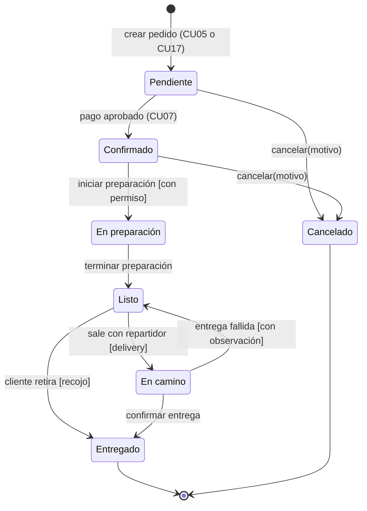

El estado resaltado, Confirmado, es la puerta: sin él no hay preparación. Un pedido se cancela solo desde Pendiente o Confirmado (RN14). El recojo salta de Listo a Entregado sin pasar por En camino, y una entrega fallida devuelve el pedido a Listo con observación (RN13).

### 5.2 Pago

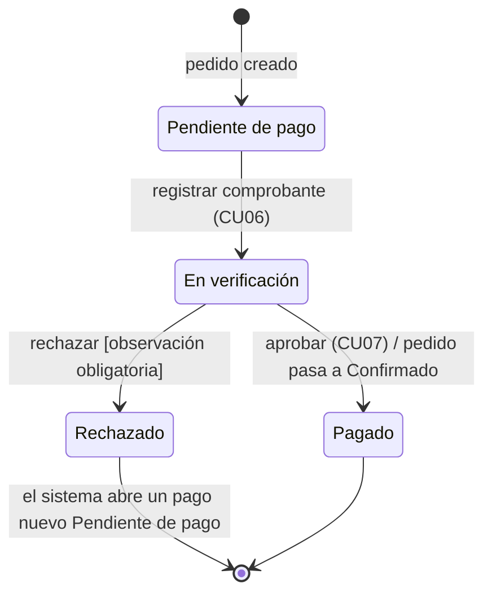

Un rechazo exige observación y reabre el cobro: el pago rechazado queda como está, con su comprobante y su motivo, y el sistema abre un pago nuevo en Pendiente de pago. Así un pedido puede acumular varios pagos hasta que uno se apruebe (RN07). Aprobar un pago es el único evento que cambia el estado de otro objeto, el pedido.

## 6. Consistencia entre modelos

Los cuatro modelos usan los mismos nombres. Esta tabla muestra dónde aparece cada elemento clave en cada modelo y qué regla lo sostiene.

| Elemento | Casos de uso | Clases | Componentes | Estados | Regla o requisito |
| --- | --- | --- | --- | --- | --- |
| Roles fijos | Actores Cliente, Administrador, Vendedor, Repartidor | Usuario, Cliente, Personal, Rol, Permiso | Seguridad, IAutenticacion | Guardas \[con permiso\] | RN16, D6 |
| Pedido | CU05, CU15, CU16, CU17 | Pedido, LineaPedido, HistorialEstado | E-commerce, IPedidos | Máquina del Pedido | RF13, RF43 |
| Pago antes de preparar | CU06, CU07 | Pago, Verificacion | Cobros requiere IPedidos | Pagado lleva el pedido a Confirmado | RN05, D1 |
| Rechazo de pago | CU07 alt. 1 y 2 | Verificacion.observacion | Cobros | En verificación a Rechazado, y un pago nuevo Pendiente de pago | RN07 |
| Cancelación | CU16 | Pedido.motivoCancelacion | IPedidos | Desde Pendiente o Confirmado | RN14, D8 |
| Entrega fallida | CU08 alt. 2 | Entrega.observacionFallo | Distribución, IEntregas | En camino a Listo | RN13 |
| Recojo | CU08 | Pedido.tipoEntrega | Distribución | Listo a Entregado | RN12 |
| Total y envío | CU05 | Pedido.calcularTotal(), Configuracion.tarifaEnvio, OpcionElegida | E-commerce | — | RN11, D4, D9 |
| Mensaje de la torta | CU05 alt. 3b | LineaPedido.mensaje (hasta 24 caracteres, límite fijo) | E-commerce | — | RN17 |
| Disponibilidad manual | CU02, CU04 | Producto.disponible (sin relación con ItemInventario) | IProductos, IStock separadas | — | RN08, D2 |
| Auditoría | CU07, CU09 | Auditoría (usuarios y permisos), Verificacion (pagos) | Seguridad, Cobros | — | RF28, RNF08 |

Dos supuestos de modelado que el equipo puede cambiar: un pedido tiene varios pagos (uno por intento) y la entrega es una clase aparte que solo existe para pedidos con delivery.

## 7. Cambios en las versiones 1.1 a 1.4

| Elemento | Cambio | Motivo |
| --- | --- | --- |
| MetodoPago | Pasa de enumeración a clase con nombre, instrucciones, QR e indicador activo | RNF18 pide agregar métodos de pago sin cambiar código, y CU06 muestra los datos para pagar |
| Pago | Guarda una copia del nombre del método | Que renombrar un método no altere pagos anteriores |
| Configuracion | Se quita maxMensaje | RN17 fija el límite en 24 caracteres; no es un valor configurable |
| Usuario | Agrega debeCambiarContrasena | El personal cambia la contraseña que le restableció el administrador (D5) |
| Sesion, RecuperacionContrasena | Clases nuevas | Cerrar sesiones por inactividad (RNF06) y recuperar la contraseña con un enlace de un solo uso (CU12) |
| MovimientoInventario | Agrega stockResultante | El historial muestra el stock que dejó cada movimiento (RF31) |
| AsignacionEntrega | Clase nueva | Registrar cada cambio de repartidor (CU08, alt. 4) |
| Componentes | Evento PedidoRegistrado | Cobros abre el pago sin que E-commerce dependa de Cobros |
| Interfaces (v1.4) | Tabla de qué clase implementa cada interfaz del modelo de componentes. En el código se agregan IProductos, IStock, IPagos e IEntregas, que el diagrama ya tenía | El código no tenía cuatro de las seis interfaces; Pedidos leía el catálogo directamente y el catálogo leía las líneas de pedido |
| Estado del pago (v1.4) | Rechazado es un estado final; el sistema abre un pago nuevo | El diagrama decía que el mismo pago volvía a Pendiente de pago, y el de clases ya mostraba varios pagos por pedido |
| ImagenProducto, Comprobante, QrMetodoPago (v1.4) | Clases nuevas en el diagrama, en lugar de los atributos imagen, comprobante y qr | Ya eran clases en el código: separan los archivos para no cargarlos en cada lectura |
| LineaPedido, OpcionElegida, Pedido, Pago (v1.4) | Se agregan nombreProducto (copia), tipo, creado; esAsistido pasa a método | El diagrama no mostraba datos que el código ya guardaba |
| Despliegue (v1.3) | Sección 4.1 nueva: nodos de Render, Neon, Brevo y GitHub Actions | Documentar dónde corre cada componente al publicar el sistema en la nube (RNF21) |
